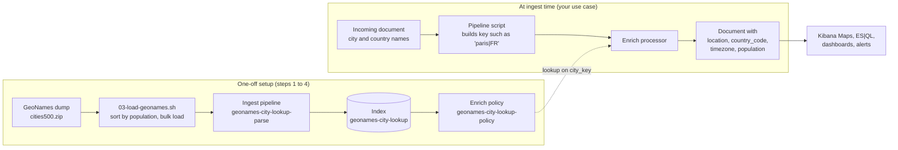

# Elastic GeoNames: geocode cities and countries in Elasticsearch

Turn plain `city` and `country` text into map-ready coordinates, at ingest time, with no external geocoding
service. This repository loads the public [GeoNames](https://www.geonames.org/) city list (about 208,000 places
with 500+ inhabitants) into Elasticsearch as a lookup index, and shows how to use an enrich policy to add a
`geo_point`, ISO country code, timezone and population to any document that carries a city and a country.

Typical uses: put business data on a Kibana Map, filter by distance, group by country or timezone, or normalise
messy location names. A complete worked example is included: the [MIMO tablets](use-cases/mimo-tablets/README.md)
use case.

## Table of contents

- [How it works](#how-it-works)
- [Setup](#setup)
- [Using it from your own pipeline](#using-it-from-your-own-pipeline)
- [Use cases](#use-cases)
- [Design notes](#design-notes)

## How it works

1. **Setup (once):** the GeoNames file is sorted by population and bulk-loaded through a parsing pipeline into
   `geonames-city-lookup`. An enrich policy snapshots that index.
2. **Ingest (every document):** your pipeline turns the city and country names into a key (`<city>|<ISO code>`),
   and the enrich processor looks it up and copies the coordinates and metadata onto the document.
3. **Use:** the document now has a `geo_point`, ready for Kibana Maps and geo queries.

## Setup

| Step | File | Where |
| --- | --- | --- |
| 1 | `01-lookup-index.console` | Kibana Dev Tools |
| 2 | `02-parse-pipeline.console` | Kibana Dev Tools |
| 3 | `03-load-geonames.sh` | shell (`ES_URL`, `ES_API_KEY`) |
| 4 | `04-enrich-policy.console` | Kibana Dev Tools |

- `ES_URL` must be the Elasticsearch endpoint (`https://<name>.es.<region>.<provider>.elastic-cloud.com`), not
  the `*.ingest.*` managed ingest proxy, which does not support index, pipeline or enrich APIs.
- The API key needs `create_index` and `write` on `geonames-city-lookup`, plus `manage_pipeline` and
  `manage_enrich`.
- `DATASET` selects the file: `cities500` (default, about 208,000 cities), `cities1000`, `cities5000`,
  `cities15000`.
- Re-run the `_execute` call of step 4 after every reload of `geonames-city-lookup`.

Current state on the reference cluster: lookup loaded (208,068 cities), enrich policy executed.

## Using it from your own pipeline

Build the key `<city lowercase>|<ISO 3166-1 alpha-2 country code>` into a temporary field, run an enrich
processor with policy `geonames-city-lookup-policy` on it, and copy what you need from the match.

| Enriched field | Type | Example |
| --- | --- | --- |
| `location` | geo_point | `48.137, 11.575` |
| `country_code` | keyword | `DE` |
| `geonameid` | long | `2867714` |
| `population` | long | `1505005` |
| `timezone` | keyword | `Europe/Berlin` |
| `city` | keyword | `Munich` |

Add a `geo_point` mapping for the field you copy `location` into. The MIMO use case has a complete working
pipeline: [`01-metrics-sql-enrichment.console`](use-cases/mimo-tablets/01-metrics-sql-enrichment.console).

## Use cases

| Use case | What it does |
| --- | --- |
| [MIMO tablets](use-cases/mimo-tablets/README.md) | Geocodes the MIMO tablet SQL metrics (`metrics-sql-default`) from city and country names, and shows the tablets on a multi-layer Kibana Map. Includes a customer demo deck (`fslides serve`). |

To present the MIMO deck: `cd use-cases/mimo-tablets/deck && fslides serve` (see the use case README for the run of
show and exports).

To add a use case, create `use-cases/<name>/` with its own README, ingest pipeline and verification queries,
and list it in the table above.

## Design notes

- **Join key** is `<city lowercase>|<ISO country code>`. City alone is ambiguous worldwide.
- **Accents**: each lookup row has both the accented and the ASCII key (`köln|DE`, `koeln|DE`), stored in the
  multi-valued `city_key`.
- **Duplicates**: one row per ASCII key (`_id`); the most populated city wins because the load script sorts by
  ascending population and loads sequentially.
- **English names**: GeoNames uses English main names (`Rome`, `New York City`), so source data with local
  names needs aliases in the calling pipeline.
- **CSV quoting** is disabled in the parse pipeline (`"quote": "\u0001"`): a few GeoNames rows contain a stray
  `"` that otherwise fails the bulk load.
- **Centroids**: coordinates are city centres, not street addresses.
