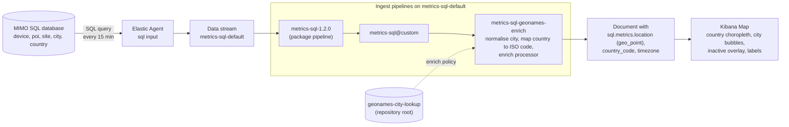

# MIMO tablets: see every tablet office on a Kibana map

The MIMO room-booking tablets report their state to a SQL database, which Elastic Agent already collects into
`metrics-sql-default` every 15 minutes. The data only says *where* a tablet is as text (`country: Germany`,
`city: Munich`), so it cannot be drawn on a map. This use case geocodes that text at ingest time, using the
GeoNames lookup from the [repository root](../../Readme.md), and describes a multi-layer Kibana Map that shows
the tablets per country and per city.

Prerequisite: run the setup steps 1 to 4 of the [root Readme](../../Readme.md) first.

## Table of contents

- [How it works](#how-it-works)
- [Run order](#run-order)
- [Map](#map)
- [Presentation deck](#presentation-deck)
- [Design notes](#design-notes)

## How it works



1. **Collect:** one document per tablet per snapshot, with `sql.metrics.country`, `sql.metrics.city`,
   `sql.metrics.uuid` and `sql.metrics.status`.
2. **Geocode:** the package pipeline calls `metrics-sql@custom`, which runs `metrics-sql-geonames-enrich`. It
   cleans the city name, converts the country name to its ISO code, and looks the pair up in GeoNames.
3. **Map:** the new `sql.metrics.location` field feeds the Kibana Map layers.

## Run order

| Step | File | Where |
| --- | --- | --- |
| 1 | `01-metrics-sql-enrichment.console` | Kibana Dev Tools (run the 1.0 checks first) |
| 2 | `02-verify.console` | Kibana Dev Tools |
| 3 | `03-map-layers.md` | Kibana Maps (manual) |
| 4 | `deck/` | fslides presentation for the customer demo |

## Map

[`03-map-layers.md`](03-map-layers.md) describes a Mercator map with four layers: country choropleth
(zoom 0 to 4), tablets per city, inactive tablets, and city labels (zoom 5 and up). The three city layers use
the same ES|QL query.

## Presentation deck

[`deck/`](deck/) is a six-slide [fslides](https://fslides.dev) deck in the `elastic-web` style, for a customer demo.

| # | Slide | Purpose |
| --- | --- | --- |
| 1 | Cover | The idea in one picture: every tablet on a world map |
| 2 | Challenge | The registry knows location only as text |
| 3 | How it works | MIMO registry, Elastic Agent, GeoNames lookup, Kibana |
| 4 | Demo 1 | Go from the world to a single room (estate map) |
| 5 | Demo 2 | Plan support and rollouts across time zones |
| 6 | Close | Customer value and the next step |

Speaker notes for every slide are in [`deck/notes.json`](deck/notes.json).

### Present it

Prerequisites: Node.js and the fslides CLI (`npm install -g fslides`).

```bash
cd use-cases/mimo-tablets/deck
fslides serve
```

`fslides serve` opens the deck in your browser (by default at `http://localhost:3000`; if the port is taken, stop the
other process first). The player gives you slide navigation, an overview grid and a notes panel that shows the
speaker notes from `notes.json`. Slides reload when you save a file.

Suggested run of show (about 15 minutes):

1. Slides 1 to 3 (about 3 minutes): the idea, the challenge, how it works.
2. Slide 4, then switch to the live Kibana dashboard and follow the click path in the slide notes: overview numbers,
   the map from world to city, a country filter, buildings, the room table.
3. Slide 5, then the dashboard's Timezone section: distinct time zones and the tablets-by-timezone chart.
4. Slide 6: the value, and the next step (detect a silent office, which needs a heartbeat signal).

Before the meeting:

- The figures on the slides (689 tablets, 41 cities, 18 countries, tablets per time zone) and the cover map are an
  illustrative sample fleet, not real customer data. Replace them with your own numbers from the live dashboard.
- Set the dashboard time range to at least the last 30 minutes, so the map is not empty.
- Open only the dashboard sections that hold real data (estate map, room capacity, timezone), as the slide notes say.

### Edit and export

Slides are plain HTML files in `deck/slides/`, registered in `deck/fslides.config.js`. Export with:

```bash
fslides pdf        # mimo-tablets-demo.pdf
fslides export     # one self-contained HTML file
fslides pptx       # PowerPoint
```

If `fslides pdf` cannot find Chrome, set `PUPPETEER_EXECUTABLE_PATH` to your Chrome binary, for example
`/Applications/Google Chrome.app/Contents/MacOS/Google Chrome` on macOS.

## Design notes

- **Country names to ISO codes** are mapped in the script of `metrics-sql-geonames-enrich`
  (the 18 countries of the sample fleet). Add a line when a new country appears.
- **Parenthetical suffixes** are stripped (`Brussels (Bruxelles)` becomes `brussels`).
- **Aliases** for spellings GeoNames does not use as main name: `wien` to `vienna`,
  `praha` to `prague`, `milano` to `milan`, `torino` to `turin`, `zurich` to `zürich` (GeoNames uses English names,
  for example `Vienna`, but keeps the local spelling for some cities, for example `Zürich`).
- **Hook**: the `metrics-sql` index template (package-managed) includes `metrics-sql@custom`, and the package
  pipeline `metrics-sql-1.2.0` calls the `metrics-sql@custom` pipeline, so no template change was needed.
- **No backfill**: the SQL input snapshots every tablet every 15 minutes, so only new data matters.
  Documents before the rollover have no `sql.metrics.location`.
- **Misses** get the tag `geonames_no_match` (query in step 2.3).
- **`sql.metrics.uuid`** is the device identifier of one physical tablet; use
  `COUNT_DISTINCT` on it to count tablets, not documents.
- **`data/sample_country_city.csv`**: illustrative sample fleet (cities and tablet counts, not real customer data).
  It has the shape of the export used to check lookup coverage. Reference only; no step reads it.
- **Precision**: pins are city centroids. Office-level precision needs an `office-locations` list keyed by `site`.
- **Fallback** if the `@custom` hook ever stops firing: set `index.final_pipeline` to
  `metrics-sql-geonames-enrich` in a custom index template for `metrics-sql-*`.
